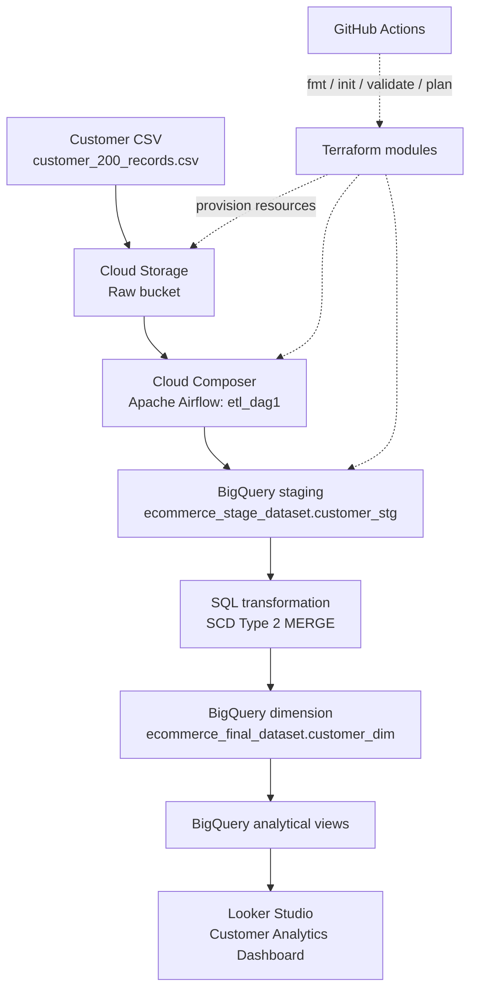

<div align="center">

# 🛒 E-commerce Customer Analytics on Google Cloud

**End-to-end GCP data engineering | BigQuery | Cloud Composer | Airflow | Terraform | GitHub Actions | Looker Studio**

[](https://github.com/cloudwithpavan/E-com-project/actions/workflows/terraform-ci.yml)


</div>

---

## 📌 Project Overview

This project demonstrates an end-to-end customer data pipeline on **Google Cloud Platform (GCP)**. A customer CSV is stored in Cloud Storage, loaded into BigQuery staging, transformed into a customer dimension using **Slowly Changing Dimension Type 2 (SCD Type 2)** logic, and made available for reporting in Looker Studio.

**Terraform** manages cloud infrastructure. **GitHub Actions** checks Terraform formatting, initialization, validation, and plans. GitHub-to-Google-Cloud authentication uses Workload Identity Federation rather than a long-lived service-account key.

## 🏗️ Architecture Diagram



### Pipeline flow

1. **Source:** 200 sample customer records in a CSV file.
2. **Storage:** Raw input is stored in Google Cloud Storage.
3. **Orchestration:** Cloud Composer runs the `etl_dag1` Airflow DAG.
4. **Staging:** Data is loaded to `ecommerce_stage_dataset.customer_stg`.
5. **Transformation:** SQL merge logic applies SCD Type 2 behavior.
6. **Analytics:** The final customer dimension and BigQuery views support reporting.
7. **Dashboard:** Looker Studio visualizes customer metrics.
8. **Infrastructure automation:** Terraform provisions resources and GitHub Actions validates Terraform changes.

## 🧰 Technology Stack

| Area | Technology | Purpose |
|---|---|---|
| Cloud | Google Cloud Platform | Hosts pipeline and data services |
| Object storage | Google Cloud Storage | Raw, cleaned, and unprocessed data areas |
| Data warehouse | BigQuery | Staging, transformations, customer dimension, views |
| Orchestration | Cloud Composer / Apache Airflow | Runs the ETL workflow |
| Data modeling | SQL / SCD Type 2 | Preserves customer history |
| Infrastructure as Code | Terraform | Provisions cloud infrastructure |
| CI | GitHub Actions | Terraform fmt, init, validate, plan |
| Authentication | Workload Identity Federation | Keyless GitHub Actions authentication |
| BI | Looker Studio | Customer analytics dashboard |
| Source control | Git / GitHub | Versioning and collaboration |

## ☁️ GCP Resources

### Cloud Storage

| Bucket | Intended role |
|---|---|
| `ecommerce-analytics-raw-lct2026` | Raw customer input |
| `ecommerce-analytics-cleaned-lct2026` | Cleaned/processed data area |
| `ecommerce-analytics-unprocessed-lct2026` | Unprocessed or rejected data area |

### BigQuery and orchestration

| Resource | Name |
|---|---|
| GCP project | `my-project-77-511616` |
| Composer region configured in Terraform | `us-central1` |
| BigQuery dataset location | `US` |
| Staging dataset | `ecommerce_stage_dataset` |
| Staging table | `customer_stg` |
| Final dataset | `ecommerce_final_dataset` |
| Customer dimension | `customer_dim` |
| Composer environment | `ecommerce-composer-dev` |
| Airflow DAG | `etl_dag1` |

## ✅ Pipeline Outputs and Validation

These are the observed results shared during the initial-load validation:

| Validation | Observed result |
|---|---:|
| Sample customer records | 200 |
| Rows in staging table `customer_stg` | 200 |
| Rows in final table `customer_dim` | 200 |
| Current customer versions after initial load | 200 |
| Historical customer versions after initial load | 0 |
| Duplicate current customer records found | 0 |
| Looker Studio source scorecard shown in the screenshot | 200 |

### Interpretation

- The staging table contained all 200 sample records.
- The final customer dimension contained 200 rows after the initial load.
- All 200 records were current versions; no prior versions existed to preserve during that initial load.
- The validation query found no duplicate current customer records.

**SCD Type 2 note:** Historical versions are expected after tracked customer attributes change and the pipeline processes the changed records. Zero historical versions on the initial load is expected, but does not alone prove the update path has been tested.

## 📊 Looker Studio Dashboard

A report named **E-commerce Customer Analytics Dashboard** was created and connected to the BigQuery customer dimension. The screenshot shows a scorecard value of **200**.

Suggested dashboard metrics:

- Total customers
- Active customers
- Inactive customers
- Distinct cities
- Customer distribution by country, state, and city
- Signup trends by month
- Customer status distribution

**Live dashboard:** Add the published Looker Studio report URL here after setting the intended sharing permissions.

### Add screenshots to GitHub

Save the screenshots you want to publish in `docs/images/`, commit them, then uncomment and update the relevant Markdown paths:

```markdown
<!--  -->
<!--  -->
<!--  -->
<!--  -->
```

Only publish screenshots that do not expose private account, billing, or personal information.

## 🔁 SCD Type 2 Design

The final customer dimension is designed to retain historical versions using effective start/end dates and a current/historical indicator.

Typical flow:

1. Insert a new customer as the current version.
2. When tracked attributes change, close the previous version.
3. Insert a new current version for the changed customer.
4. Keep old versions available for historical analysis.

Refer to the DAG/SQL source for the exact merge conditions and column names.

## 🗂️ Repository Structure

```text
E-com-project/
├── .github/
│   └── workflows/
│       └── terraform-ci.yml
├── airflow/
│   └── pipeline_automation_dag.py
├── terraform/
│   ├── main.tf
│   ├── variables.tf
│   ├── terraform.tfvars
│   └── modules/
│       ├── gcs/
│       ├── bigquery/
│       └── composer/
├── data/
│   └── customer_200_records.csv
├── bq/
├── gcs/
├── test_cases/
├── docs/
│   └── images/
└── README.md
```

*This is the intended layout based on the project work. Remove or adjust any paths that do not exist in the current repository.*

## 🚀 Setup and Run

### Prerequisites

- GCP project with billing and required APIs enabled
- Google Cloud CLI and Terraform installed
- Permissions to manage the required GCP resources
- Access to the GitHub repository and source CSV

### 1. Clone

```bash
git clone https://github.com/cloudwithpavan/E-com-project.git
cd E-com-project
```

### 2. Review and validate Terraform

```bash
cd terraform
terraform init
terraform fmt -check -recursive
terraform validate
terraform plan
```

Review the plan and costs carefully before applying. Cloud Composer and other resources may incur charges.

```bash
terraform apply
```

### 3. Upload the source data

Upload `customer_200_records.csv` to the configured raw bucket. Make sure the GCS object path matches the path expected by the Airflow DAG.

### 4. Run the Airflow pipeline

Deploy `airflow/pipeline_automation_dag.py` to the Composer DAGs folder if it is not already deployed. In the Airflow UI, locate `etl_dag1`, trigger it, and review task logs.

### 5. Validate results in BigQuery

```sql
SELECT COUNT(*) AS staging_rows
FROM `my-project-77-511616.ecommerce_stage_dataset.customer_stg`;

SELECT COUNT(*) AS final_rows
FROM `my-project-77-511616.ecommerce_final_dataset.customer_dim`;

SELECT
  COUNTIF(end_date IS NULL) AS current_versions,
  COUNTIF(end_date IS NOT NULL) AS historical_versions
FROM `my-project-77-511616.ecommerce_final_dataset.customer_dim`;
```

The recorded initial-load results were 200 staging rows, 200 final rows, 200 current versions, and 0 historical versions. Results can differ if input data or pipeline logic changes.

### 6. Connect Looker Studio

Connect the report to the intended BigQuery table or analytical views, configure charts and filters, then share the report only with the intended audience.

## ⚙️ GitHub Actions — Terraform CI

The workflow `.github/workflows/terraform-ci.yml` runs on pushes and pull requests to `main`, and supports manual runs. It performs:

- Terraform formatting check
- Terraform initialization
- Terraform validation
- Terraform plan

Authentication uses **Workload Identity Federation**. Keep repository variables and IAM bindings aligned with the intended project and repository. Prefer least-privilege IAM roles. The current workflow validates and plans changes; it should not be described as automatically applying infrastructure unless an apply step is explicitly configured.

## 🔐 Security and Cost

- Never commit service-account JSON keys, passwords, tokens, or other secrets.
- Use Workload Identity Federation for GitHub Actions.
- Grant only the IAM roles required by each identity.
- Review Terraform plans before applying.
- Monitor Cloud Composer and other resource costs.
- Delete resources when they are no longer needed.
- Do not publish screenshots containing private account or billing details.

## 🎯 Key Learning Outcomes

- Building a GCP end-to-end data pipeline
- Loading data from GCS to BigQuery
- Applying SCD Type 2 data modeling
- Orchestrating ETL with Airflow and Cloud Composer
- Provisioning infrastructure with reusable Terraform modules
- Validating infrastructure changes with GitHub Actions
- Keyless GitHub-to-GCP authentication
- Preparing BigQuery data for Looker Studio analytics

## 👤 Author

**Pavan Kumar** · [GitHub @cloudwithpavan](https://github.com/cloudwithpavan)

---

<div align="center">

*Built as a hands-on GCP Data Engineering portfolio project.*

</div>
